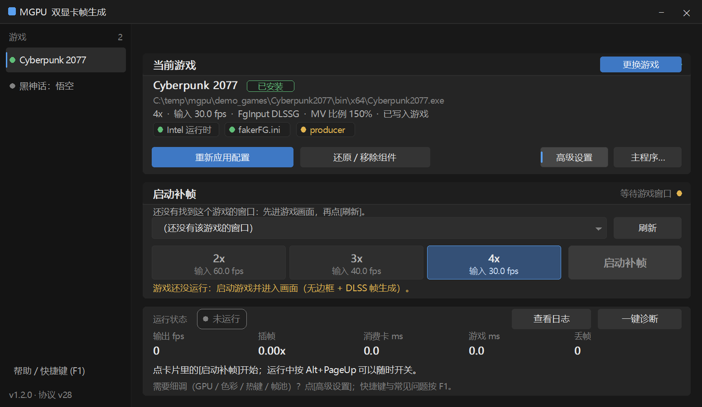
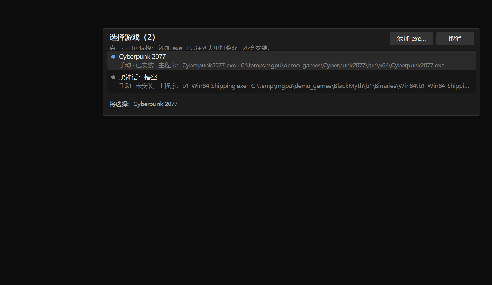
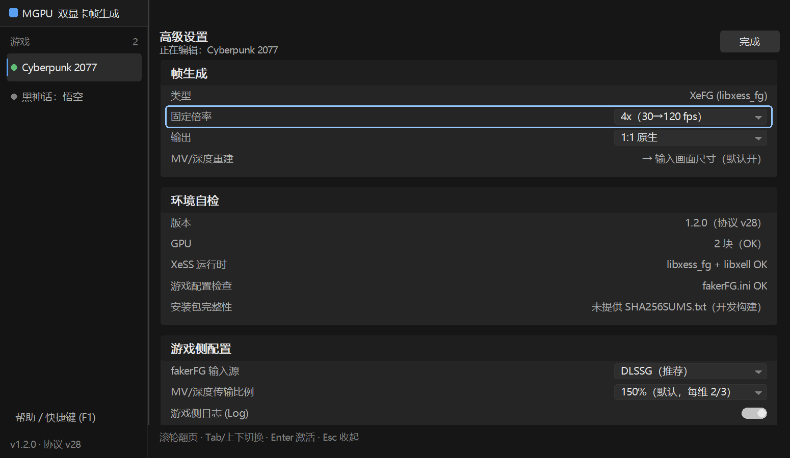

# mgpu / lock_frame

**把游戏的渲染和帧生成拆到两块 GPU 上。** 游戏照常在自己的显卡上渲染 + 超分，
`lock_frame` 在另一块显卡上用 XeSS-FG 插帧，再叠加回游戏窗口上屏——
目标是在不换显卡的情况下把帧数翻倍到 4 倍。

> **项目状态（1.2.9，2026-11-23）：核心功能已到尽头。**
> 跨卡传输、无损 MV/depth 码流（协议 v32）、2x/3x/4x 调度、逐游戏输入适配、UI 客户端
> 都已落地并实机验证；后续不再规划新的核心功能，只做两件事：
>
> 1. **修复收到的 issue**（崩溃、黑屏、配对错误、性能回退等）；
> 2. **增加对其他游戏的支持**（新游戏适配、输入 quirk 补行、日志核对）。
>
> 已知无解/不做的东西（UI 合成通用方案、跨卡颜色传输、反作弊在线游戏）见下方
> [「维护范围」](#维护范围)。提交问题时请附上「一键诊断」包和日志，见[反馈](#反馈)。

当前正式版：**lock_frame 1.2.9**（共享协议 v32，GPL-3.0）。
MV/depth 默认走**无损码流**（MV 100% 比特精确、depth 150%，硬件不支持时自动退回拷贝路径）；
发布包**自带 Intel 运行时**（`libxess_fg.dll` / `libxell.dll`），解压即用；
安装时它们会被写入 `<游戏>\fakerFG\`（1.2.1 起的修复：游戏进程里的 XeFG 只从这里加载）。
1.2.7 起内置 **OptiScaler 逐游戏 FG 输入表**（按 `--game` 自动套用，UI 里可关）；
1.2.9 起 `FgInput` 固定 **DLSSG**（写其他值会被强制回 `DLSSG`，`NoFG` 仍可显式禁用）。
游戏侧配置模板分两版：`fakerFG.ini`（精简，发布默认）与 `fakerFG.full.ini`（测试全参数），
在 UI 的「游戏侧配置 → 配置版本」切换。

> UI 合成（HUDless + XeFG mode 5）仍是**实验性**：边缘/半透明 UI 会出现拖影或伪影，
> 发布默认关闭（`UiStream=0` / `UiSource=Off`），只在显式本地 A/B 时手动打开，
> 见 [`lock_frame/docs/UI_SYNTHESIS_GATE.md`](lock_frame/docs/UI_SYNTHESIS_GATE.md)。



> 小白向图文教程：[`docs/bilibili/使用说明.md`](docs/bilibili/使用说明.md)（可直接发 B 站专栏）。
> 详细技术文档：[`lock_frame/docs/README.md`](lock_frame/docs/README.md)。

## 这个工具适合谁

- 有两块显卡（核显 + 独显，或两张独显），想把游戏帧数再往上推；
- 游戏本身支持 **DLSS Frame Generation**，并且能开 **无边框 / 窗口化全屏**；
- 单机 / 离线游戏。

**不适合**：带反作弊的在线游戏、必须独占全屏的游戏、只有一块显卡还想零损耗的用户
（单卡能跑，但会和游戏抢性能）。

## 5 分钟上手

1. **解压**发布包到任意可写目录（不要只解压进游戏目录），双击 `lock_frame_ui.exe`。
2. 首次启动看欢迎页 → 点「知道了，开始」。
3. 点「当前游戏」卡片右上角的 **选择游戏** → 「添加 exe…」选中游戏主程序
   （例如 `Cyberpunk2077.exe`），列表里点它一下即可。
4. 回到主界面点 **安装 / 应用配置**：会把组件装进游戏目录，并把你当前的配置
   写进游戏里的 `fakerFG.ini`。
5. 启动游戏、进画面、开启 **DLSS 帧生成**（无边框 / 窗口化全屏），回到工具点 **刷新**：
   窗口和 producer 就绪后，「启动补帧」按钮亮起，点它即可。

| 选择游戏 | 高级设置 |
|---|---|
|  |  |

```text
首次启动
  └─ 选择游戏（添加 exe） → 安装 / 应用配置
        └─ 进游戏（无边框 + DLSS FG） → 刷新 → 启动补帧
              └─ 想调参数：操作行的「高级设置」（改的是当前游戏的配置）
```

## 每个游戏的配置存在哪

- 主配置（索引 + 全局 UI 偏好）：`lock_frame_ui.ini`
- 单游戏配置：`profiles\<游戏名>.ini`（倍率、输入源、MV 比例、GPU、OSD…全部在这里）
- 游戏侧配置：`<游戏目录>\fakerFG.ini`（安装/重新应用时写入，改前自动备份，保留 8 份）
- 日志：`lock_frame_ui.log` 与 `lock_frame_ui_HHMMSS.txt`

全部在 exe 旁边，便携式，不写注册表 / AppData。

## 核心功能

| 功能 | 说明 |
|---|---|
| 固定倍率 | 2x / 3x / 4x（120Hz 面板建议锁 60 / 40 / 30 fps） |
| fakerFG 输入源 | 固定 DLSSG（Streamline tag）；其他值强制回 `DLSSG`，`NoFG` 可显式禁用 |
| 游戏侧配置模板 | `fakerFG.ini`（精简，默认）/ `fakerFG.full.ini`（测试全参数），UI 内切换 |
| 就绪检查 | 安装、Intel 运行时、游戏窗口、producer、fakerFG.ini 五项状态 |
| 安装 / 还原 | 一键部署（自动备份 `dxgi.dll`）与一键还原；游戏运行中会拦截 |
| 配置管理 | 一游戏一配置（`profiles\*.ini`），点名字可重命名，ini 漂移会提示重新应用 |
| 逐游戏适配 | 内置 OptiScaler FG 输入表（49 行），按 `--game` 自动套用；`--game-quirks apply/log/off`，UI 可关 |
| 诊断 | 一键诊断包、内嵌 400 行日志、`pair:`/OSD 指标 |
| 界面 | 中/英双语、DPI 缩放、键盘操作、UIA 读屏 |


## 渲染卡的额外开销（实测）

只有**渲染卡**（游戏所在的那块）的时间会影响帧率。消费卡在 3x@40 下还有约 88% 余量，
所以消费端的 sparse unblend、解码、VRAM 优化都不会体现在 fps 上——要省时间只能省渲染卡。
下面全部是实机数字，不是名义带宽折算。

实测环境：CP2077 4K DLAA、锁 40 fps、3x 输出；渲染 **RTX 3080 Ti**，帧生成 **RX 6750 GRE**；
1.2.9 默认（MV 100% / depth 150%）。换卡、换游戏、换分辨率都会变。

### 按 pass 拆（`prof:`，UI 合成开启时）

| 来源 | 4K/帧 | 占 25.6 ms 预算 | 说明 |
|---|---:|---:|---|
| MV 编码（100%，比特精确） | 0.7–1.3 ms | 2.6–5.0% | 同一内核，随内容位宽分布波动 |
| depth 编码（150%） | 0.79 ms | 3.1% | 1.2.7 的 2.05 ms → **−61%** |
| UI 编码（全分辨率，实验性） | 0.61 ms | 2.4% | 空 tile 走 sparse，1.36–1.55 MB/帧 |
| UI synth（`P − H`，实验性） | 0.20 ms | 0.8% | 只在开 UI 合成时产生 |
| **合计** | **2.9 ms** | **≈11%** | 名义 pass 时间；与游戏剩余工作重叠，RTSS 边际约 **+9 个百分点** |

### 按配置拆（RTSS 采样，相对游戏原生）

| 配置 | 渲染卡占用 | 增量 |
|---|---:|---:|
| 游戏原生（DLSS-G，不开本工具） | 94% | — |
| + producer（MV/depth 降采样 + 无损编码，不开 consumer） | 97.5% | **+3.5 pp** |
| + consumer（WGC 颜色捕获 + present 侧配对），UI 合成关 | 100% | **+2.5 pp** |
| + UI 合成（sparse，实验性；1/2 优化前为 105%） | 103% | **+3 pp** |

### 开销来源说明

- **跨卡 MV/depth（固定开销）**：在游戏进程里跑两个全屏降采样 pass + 无损编码，再加跨卡 DMA，
  全部落在渲染卡上，这是上表 `+3.5 pp` 的主体。
- **WGC 颜色捕获（固定开销）**：颜色**不跨卡**（消费端单卡抓取），但捕获和 present 侧配对
  发生在游戏那张卡上，加 consumer 后约 `+2.5 pp`。旧的可选跨卡颜色流实测把渲染卡从
  **80% 推到 95%（+15 pp）**，因此已废弃（`ColourStream=0`）。
- **UI 合成（唯一随开关变化的一项）**：`synth 0.20 + encode 0.61 ≈ 0.8 ms/帧`，约 `+3 pp`；
  sparse UI codec 把这条链从 105% 压到 103%。发布默认关闭。
- **消费端（XeFG 插帧、unblend、叠加）在副卡**，不占渲染卡；只有副卡与游戏同卡时才会
  抢同一张 GPU（日志会写 `note: same GPU as the producer`），那种情况不建议使用。

出处：[`PERF_OPT_2026-11-23.md`](docs/design/PERF_OPT_2026-11-23.md) §7（逐 pass 与稀疏 A/B）、
[`UI_ITERATION_2026-11-23_SPARSE.md`](docs/design/UI_ITERATION_2026-11-23_SPARSE.md) §2.2
（94/97.5/100/103%）、[`PERF_BASELINE.md`](docs/findings/PERF_BASELINE.md) 与
[`LOSSLESS_TRANSPORT.md`](docs/design/LOSSLESS_TRANSPORT.md) §2–§3（颜色 80→95%、降采样/编码成本）。
复测方法：`fakerFG.ini` 里 `ProfGpu=1` 看 `prof:` 行，或用 `lock_frame/run_perf.bat` 跑定长段落。

## 已知限制（1.2.9）

- 全局扫描（Steam/Epic/GOG/注册表批量导入）暂从界面下线，改为手动添加 exe。
- 中文重命名依赖输入法提交字符，暂没有 IME 候选浮层。
- 没有“删除游戏配置”按钮：删掉 `profiles\*.ini` 后重启 UI 即可。
- 仅单机/离线使用；请勿用于带反作弊的在线游戏。

## 维护范围

核心功能已到尽头，1.2.9 之后的维护只覆盖下面两类工作。

**会做**

| 类型 | 范围 | 提交时请附上 |
|---|---|---|
| Bug 修复 | 崩溃、黑屏/冻死、配对错帧、帧数明显回退、安装/还原/部署失败 | 「一键诊断」包、`lock_frame_ui.log`、`<游戏>_fakerFG.log`、producer 日志 |
| 新游戏支持 | 让未验证的游戏跑起来：输入车道选择、`--game` 匹配、必要的手工 quirk | 游戏名与版本、显卡型号、是否开 DLSS FG、倍率、一次 ≥30 秒实机运行的完整日志 |

文档里写错或过时的内容也欢迎指出（请注明版本和位置）。

**不做 / 已确认无解**

- **新的插帧算法或倍率模型**：模型固定 **keep2x（model 18，所有倍率）**，
  `--mfg-model=port` 只是显式实验入口（3x 略好、4x 更差，见 `lock_frame/docs/RELEASE_NOTES_1.2.7.md`）。
- **通用 UI 合成（HUDless/unblend）**：只在标题提供 HUDless/UI 平面时可用（1.2.9 实测
  CP2077 4K 可复现），边缘/半透明 UI 仍会拖影/伪影，属实验性、默认关闭，不承诺做成
  与游戏无关的通用方案。
- **跨卡颜色传输**：颜色仍走 WGC 单卡捕获，跨卡的只有 MV/depth（以及实验性的 UI）。
- **反作弊在线游戏、独占全屏游戏**：设计上就不支持。
- **全局扫描 / 批量导入游戏**：仍从界面下线，需手动添加 exe。

不承诺修复时间：单人维护，按 issue 的先后顺序处理，能复现的优先。

## 从源码构建

```bash
./lock_frame/build.sh ui        # 只构建 UI → build/lock_frame_ui.exe
./lock_frame/build.sh all       # consumer / producer / fakerFG / UI
./lock_frame/release.sh         # 打 dist/lock_frame-<ver>.zip（默认含 Intel 运行时）
WITH_XESS=0 ./lock_frame/release.sh   # 精简包（不含 Intel DLL）
```

依赖：Windows SDK（含 `fxc`）、MSVC、Git Bash/WSL、Python 3。
详细构建与依赖说明见 `lock_frame/docs/ops/BUILD.md` 与 `docs/ops/DEPENDENCIES.md`。

## 目录

```
lock_frame/            当前主线：consumer、producer、fakerFG、UI、发布脚本
lock_frame/ui/         可视化客户端（mgpu_ui.cpp）
lock_frame/docs/       技术文档、发布说明、UI 设计
docs/bilibili/         B 站专栏图文（使用说明 + 截图）
src/                   早期实验实现（保留对照，发布以 lock_frame/ 为准）
third_party/           第三方依赖与许可（不入库，按 NOTICE 获取）
```

## 许可证与第三方

- 项目本体：**GPL-3.0**（见 `LICENSE` / `NOTICE`）。
- 随包的 Intel XeSS 运行时按 Intel 许可原样再分发（见包内
  `INTEL-XESS-LICENSE.txt`），未做任何修改。
- 其他第三方组件与许可见 `NOTICE` 与 `docs/ops/LEGAL.md`。

## 反馈

- 提交地址：<https://github.com/coder-648/mgpu-xessmfg/issues>
- 标题建议：`bug：<一句话现象>` 或 `游戏支持：<游戏名>`
- 先跑一次「一键诊断」，把生成的 zip 和 `lock_frame_ui.log` 一起提供；
- 说明游戏名、显卡型号、是否开启 DLSS FG、使用的倍率；
- 只接受 **bug 修复** 与 **新游戏支持** 两类请求（范围见[「维护范围」](#维护范围)）。
