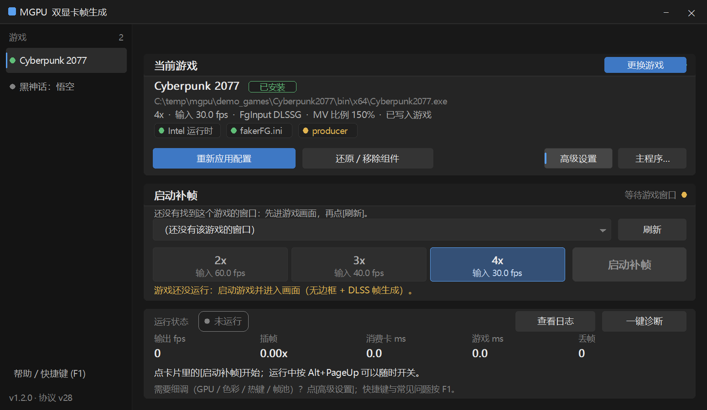
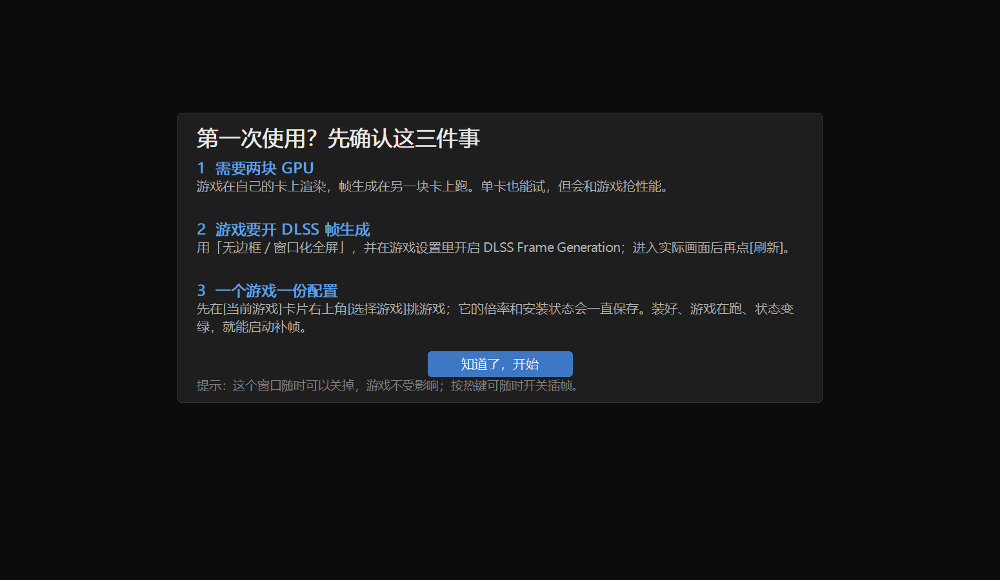
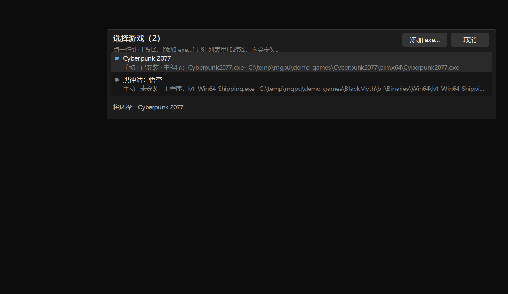
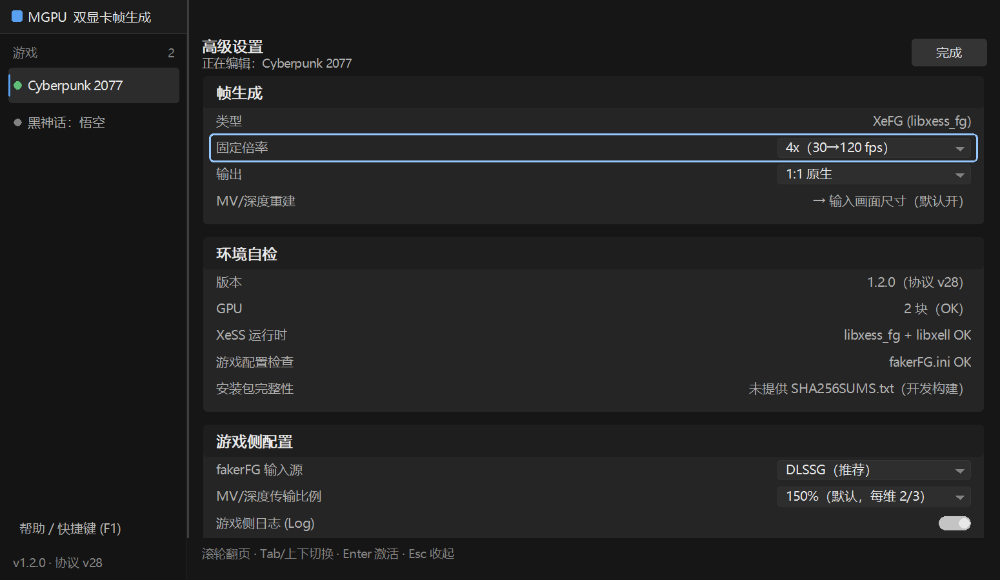

# 【图文教程】双显卡插帧 lock_frame 1.2.0：小白也能 5 分钟上手

> 本文可直接发 B 站专栏。发布前把 `images/` 里的 4 张图先上传到 B 站图床/动态，
> 再把正文里的 `images/xx.png` 替换成上传后的图片地址（或在编辑器里直接插入图片）。
>
> 标题备选：
> - 双显卡插帧实测：不换卡把游戏帧数翻倍到 4 倍（小白图文教程）
> - 核显+独显也能插帧？lock_frame 1.2.0 保姆级使用说明
> - 5 分钟上手双显卡插帧：安装 / 启动 / 还原一次讲清

---

## 0. 先说结论（给不想看长文的人）

1. 解压 → 双击 `lock_frame_ui.exe`
2. 右上角「选择游戏」→「添加 exe…」选游戏主程序
3. 点「安装 / 应用配置」
4. 进游戏开 DLSS 帧生成（无边框全屏）→ 回工具点「刷新」→「启动补帧」

**只支持单机/离线游戏，不要用于带反作弊的在线游戏。**



*（图 1：主界面。左边是游戏列表，中间是「当前游戏」和「启动补帧」，下面一排 KPI）*

---

## 1. 它是什么？适合谁？

`lock_frame` 是一个**双显卡插帧工具**：

- 游戏仍然在你的主力显卡上渲染；
- 另一块显卡（核显或第二张独显）负责"补帧"，把 30/40/60 帧补到 120 帧；
- 支持固定 **2x / 3x / 4x**，对应 120Hz 屏幕锁 60 / 40 / 30 帧。

适合：

- 有两块显卡（核显 + 独显也算）；
- 游戏支持 **DLSS Frame Generation**；
- 游戏能开 **无边框 / 窗口化全屏**；
- 单机、离线。

不适合：

- 带反作弊的网游（会封号，也别试）；
- 只能独占全屏的老游戏；
- 只有一块显卡还想"零损耗"——能跑，但会和游戏抢性能。

---

## 2. 下载与解压

1. 下载 `lock_frame-1.2.0.zip`（约 14MB）。
2. 解压到**任意可写目录**，例如 `D:\lock_frame`。
   - 不要只解压到游戏目录里；
   - 路径别带奇怪符号，中文路径一般没问题。
3. 这个版本**自带 Intel 运行时**（`libxess_fg.dll` / `libxell.dll`），不用再去官网找 DLL。

第一次打开会出现欢迎页，点「知道了，开始」即可（只出现一次）。



*（图 2：首次启动的欢迎页）*

---

## 3. 添加游戏（只需一次）

点「当前游戏」卡片右上角的 **选择游戏**：



*（图 3：选游戏面板。这里只做"选择"和"添加"，不会安装东西）*

步骤：

1. 点 **添加 exe…**；
2. 选中游戏的主程序，例如：
   - 赛博朋克 2077：`Cyberpunk2077.exe`
   - UE 游戏：`XXX-Win64-Shipping.exe`
3. 列表里出现这个游戏后，**点它一下**就选中了。

小提示：

- 名字默认就是 **exe 的名字**（去掉 .exe）。
- 名字太长/不好看？回主界面**直接点游戏名**就能改，回车保存。
- 每个游戏有自己独立的一份配置（倍率、输入源、OSD…），切换游戏不会互相污染。

---

## 4. 安装到游戏

回到主界面，点 **安装 / 应用配置**：

- 会把 `fakerFG.dll`、`dxgi.dll` 等组件复制到**游戏 exe 所在目录**；
- 原来的 `dxgi.dll` 会自动备份，之后可以点 **还原 / 移除组件** 恢复；
- 同时把当前配置写进游戏的 `fakerFG.ini`（FgInput / Capture / MV 比例 / Log）。

注意：

- **游戏必须完全退出**（包括最小化到托盘），否则会提示"请先关闭游戏"；
- 装完状态会变成绿色「已安装」。

---

## 5. 进游戏 & 启动补帧

1. 启动游戏，进入**实际画面**（不是主菜单）。
2. 游戏设置里：
   - 显示模式：**无边框 / 窗口化全屏**；
   - 开启 **DLSS Frame Generation**（帧生成）。
3. 回到工具点 **刷新**：
   - 找到窗口后，标题栏状态会变成「就绪」；
   - 「启动补帧」按钮亮起，点它。
4. 想停就再点一次（按钮变「停止」），或者用快捷键 `Alt+PageUp`。

倍率怎么选（120Hz 屏幕）：

| 倍率 | 建议游戏内锁帧 | 说明 |
|---|---|---|
| 2x | 60 fps | 最稳，兼容性最好 |
| 3x | 40 fps | 需要 `libxell.dll`（包里已带） |
| 4x | 30 fps | 最激进，低帧游戏更明显 |

---

## 6. 高级设置（可选）

点操作行里的 **高级设置**，右边会滑出子页：



*（图 4：高级设置。标题下面会写"正在编辑：当前游戏"）*

里面能改：

- 固定倍率、输出分辨率、MV/深度重建；
- fakerFG 输入源（DLSSG 推荐）、MV 传输比例、游戏侧日志；
- 消费卡 GPU、色彩（HDR/SDR）、帧池、最大延迟、OSD、热键……

改完立即保存到**当前游戏**的配置文件；点「完成」或按 `Esc` 收起。
装好之后如果手动改过游戏里的 `fakerFG.ini`，主界面会提示"ini 被改过"，
点一下「重新应用配置」就能写回去。

---

## 7. 配置和文件都在哪？

全在工具目录里（便携式，不写注册表）：

```
D:\lock_frame\
├─ lock_frame_ui.exe
├─ lock_frame_ui.ini          ← 索引 + 界面偏好
├─ profiles\
│   ├─ Cyberpunk 2077.ini     ← 这个游戏的完整配置
│   └─ 黑神话：悟空.ini
├─ fakerFG.dll / libxess_fg.dll / libxell.dll
└─ lock_frame_ui.log          ← 日志（出问题先看它）
```

游戏目录里会有：

- `fakerFG.ini`：游戏侧配置（安装/重新应用时写入）
- `fakerFG.ini.bak_xxx`：自动备份，保留最近 8 份

卸载：点「还原 / 移除组件」，或直接删除工具目录；游戏目录里的
`dxgi.dll / fakerFG.dll` 等会被还原/删除。

---

## 8. 常见问题（FAQ）

**Q1：启动补帧是灰的？**
看按钮上方提示：没选游戏 / 没安装 / 游戏没跑 / producer 未加载。按提示做即可。

**Q2：提示"请先关闭游戏"？**
安装和还原会替换 `dxgi.dll`，必须完全退出游戏（托盘也退）。

**Q3：3x/4x 实际只有 2x？**
确认 `libxell.dll` 在工具目录（本包已带）；部分游戏/驱动只支持 2x。

**Q4：游戏里菜单点不动 / 画面撕裂？**
高级设置里试 `分层窗口`（默认开）、`输入转发`、`OSD`；也可以先退回 2x。

**Q5：改了配置没生效？**
游戏侧 `fakerFG.ini` 每次进游戏只读一次，改完要**重启游戏**。

**Q6：怎么反馈问题？**
运行 `collect_diagnostics.bat`，把生成的 zip + `lock_frame_ui.log` 一起发出来，
并说明游戏名、显卡型号、是否开启 DLSS FG、用的倍率。

---

## 9. 免责声明

- 本项目为个人兴趣项目，**仅限单机/离线游戏**使用；
- 请勿用于任何带反作弊的在线游戏，由此产生的后果自负；
- 插帧效果取决于显卡、驱动、游戏实现，不保证每款游戏都一样；
- 项目基于 GPL-3.0 开源，Intel XeSS 运行时按 Intel 许可原样再分发。

---

## 附：发布到 B 站的操作提示

1. 先上传 4 张图（建议宽度 1550px，PNG）：
   `01-main.png`、`04-welcome.png`、`02-choose.png`、`03-advanced.png`；
2. 在专栏编辑器里按上面的位置插入图片；
3. 封面建议用 `01-main.png` 裁成 16:10，标题大字写
   「双显卡插帧 · 5 分钟上手」；
4. 标签：`单机游戏` `显卡` `插帧` `DLSS` `教程`；
5. 置顶评论放下载说明与"仅单机使用"的提醒。
