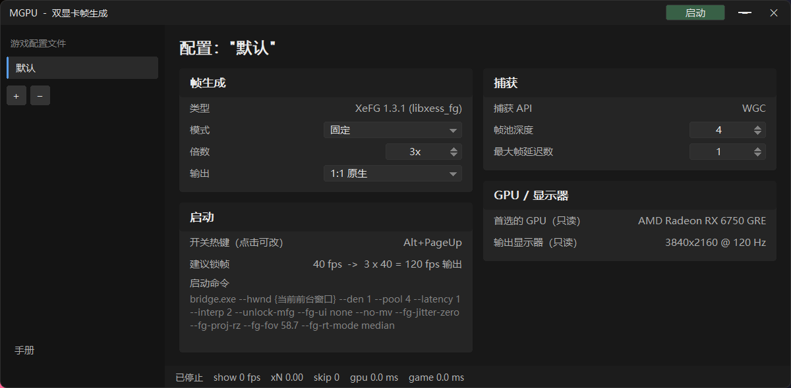

# `mgpu_ui.exe` —— Lossless-Scaling 式前端（2026-11-07）



> 截图取自较早的构建：当前界面**多了「叠加层」卡片**、**少了「高级」卡片**（FOV / 输入间隔
> 已移除），「帧生成用的 GPU」也从只读变成了下拉框，并且**不再发送** `--fg-jitter-zero`。
> 布局与配色可参考，具体以本文的卡片表为准。

外观与布局参照 **Lossless Scaling 3.2.2**：无边框深色窗口 + 自绘标题栏、左侧"游戏配置文件"
侧栏、右侧两列卡片。所有控件都是手绘的（没有子窗口控件），深色主题才能完全统一：
下拉会弹出我们自己的列表，开关是胶囊，数字是带上下箭头的步进器。

```
src/mgpu_ui/mgpu_ui.cpp      全部实现（Win32 + GDI，无第三方库）
src/mgpu_ui/build.bat        cl 构建
scripts/build_ui.sh          WSL 侧构建驱动 -> build/mgpu_ui.exe
docs/images/ui.png                  界面截图（本文顶部）
```

部署：把 `mgpu_ui.exe` 放在 **`bridge.exe` 同目录**（`<TOOLS_DIR>\`），双击运行。
它启动 bridge 时用这个目录作为工作目录（`libxess_fg.dll` 在那里）。把本文件放到
`<TOOLS_DIR>\docs\UI.md`，侧栏底部的"手册"就能直接打开它。

## 侧栏（游戏配置文件）

| 元素 | 作用 |
|---|---|
| 配置项列表 | 每个配置档独立保存下面所有设置 + 目标窗口；点一下切换 |
| `+` / `−` | 新建 / 删除配置档（至少保留一个） |
| 手册 | 打开 `docs\UI.md` |

## 卡片总览（5 张，2026-11-08 核对代码）

`帧生成` / `捕获` / `启动`（左列）、`GPU / 显示器` / `叠加层`（右列）。
每张卡片的行都直接映射到一个 `bridge.exe` 开关；改一项，卡片"启动命令"就变。

> 早期版本还有"XeFG 输入"卡和"高级"卡（FOV / 输入间隔），现在这些要么**固定发送**、
> 要么**已移除**（见本文末尾"固定参数"）。

### 帧生成

| 行 | 取值（默认 **加粗**） | 传给 bridge |
|---|---|---|
| 类型 | `XeFG 1.3.1 (libxess_fg)`（只读） | — |
| 模式 | **固定** / **动态逐帧**（两块互斥，见下） | 固定：`--interp N-1`；动态：`--interp 5 --interp-cadence` |
| *固定倍率（写死倍数）* | 分区标题 | — |
| 倍数 | 2x / **3x** / 4x / 5x / 6x（**仅固定模式可用**，动态模式下灰显） | `--interp N-1` |
| *动态逐帧（每帧按 vblank 数决定）* | 分区标题 | — |
| 输出帧率 (Hz, 0=面板) | **手输数字**：`0` = 面板刷新（填满每个 vblank）；`5`–`1000` = 上限 Hz（**仅动态模式可用**） | `--fg-out-hz N`（`0` 不发） |
| 输出 | **1:1 原生** / 5K→4K (0.75x) / 半分辨率 | `--den 1` / `--scale 0.75` / `--den 2` |
| 运动矢量 | **关闭**（默认）/ 游戏 MV / 游戏 MV (反向) / **AMD 光流**（3x 推荐） | `--no-mv` /（不带）/ `--mv-flip` / `--fg-of` |
| **抗丢帧 (A/B)** | 关（默认）/ **开**（推荐） | 开时加 `--slack-auto` |

> **抗丢帧**：OSD 的 `drop N` 数的是"我们主动丢掉了一个抓取帧"。默认策略（`--slack 0`）在
> 一次循环里拿到 2 帧时只留最新那帧 —— 延迟最低，但可能丢内容。打开这项后，**只有生产端确实
> 发布了新帧**时才会多留一帧（把丢弃换成那一帧 +1 个输入间隔的延迟），
> 重复帧（DWM 重复合成的同一画面）照旧免费丢掉。日志里能看到拆分：
> `slack-auto: N held back, M dropped [K real loss / M-K duplicate]`，**只有 K 是真丢内容**。

> **两种模式互斥**：`固定` = 每帧都插固定张数（节拍恒定，倍数由"倍数"决定）；
> `动态逐帧` = 每帧按"这一帧实际过了几个 vblank"决定插几张，输出恒定 1 帧/vblank，
> 倍数只当作 6x 上限解锁，实际倍率随输入自动变化（实测空刷新 0.4–0.8%，见
> `docs/findings/PERF_BASELINE.md` §3.18）。模式外的行会灰显并且点不动。
> 旧的 `动态（实验）`（`--dyn-mfg`）已移除：同场景空刷新 7.6%（§3.19）。

> `输出帧率` 的硬限制：`libxess_fg` **不能生成 0 帧**，所以输出至少是输入的 2 倍。
> "120 Hz 面板但只要 60 fps" 只在输入锁 **30 fps** 时成立（2x = 60）；
> 输入 60 却要 60 fps 请用 `--no-fg`（1:1 直通）；输入 40 要 60 做不到整数倍。
> 目标不可达时 bridge 会打一行 warning 说明实际会跑到多少 Hz。

### 捕获

| 行 | 取值（默认 **加粗**） | 传给 bridge |
|---|---|---|
| 捕获 API | `WGC`（只读） | — |
| **色彩空间** | **`HDR10（默认）`** / `SDR（BT.709）` | SDR 时加 `--sdr` |
| 帧池深度 | 2..6，默认 **4** | `--pool N` |
| 最大帧延迟数 | 1..3，默认 **1** | `--latency N` |

**色彩空间**：我们抓到的是 WGC 的 scRGB(FP16)，HDR 信息在链路里从不丢；这一项只决定**最后怎么编码上屏**。
默认 `HDR10` 走 BT.2020 + PQ 并把交换链声明成 HDR；选 `SDR` 走 BT.709 + gamma 2.2 并声明成 SDR。
**显示器是 SDR 就选 SDR，否则两边都发灰**：SDR 屏上跑 HDR10 会发灰发亮，HDR 屏上跑 SDR 会发灰发闷。
（这一项以前是 ini 里的死键 `sdr`：有字段、没控件、也不传给 bridge。）

### GPU / 显示器

| 行 | 说明 |
|---|---|
| **帧生成用的 GPU** | `自动`（默认：bridge 按"窗口所在显示器 / 避开游戏卡"选）或列表里任意一块 **`#i 名字`**（→ `--gpu <i>`）。列表来自 DXGI 实时枚举，不写死某家。**"A 卡渲染 + N 卡上屏"就是在这里选 N 卡** |
| 输出显示器（只读） | 当前桌面模式 |

### 叠加层（A/B 两种排查开关）

| 行 | 默认 | 传给 bridge |
|---|---|---|
| 分层窗口 (A/B) | **开**（实测这是菜单能点的关键） | `--overlay-layered` |
| 输入转发 (A/B) | 关 | `--relay-input` |
| 单行 OSD | **开** | 关掉时加 `--no-osd` |

两个 A/B 开关**互斥**（开一个自动关另一个），两个都关就是默认叠加层。
**默认勾着"分层窗口"**：影之刃零实测只有分层窗口下游戏菜单才收得到鼠标点击
（伍长待验证；`--relay-input` 是备选方案，勾它会自动关掉分层）。

**单行 OSD** 由 `bridge.exe` 自己画在游戏窗口左上角（8 px 内缩、13 px 字、半透明胶囊）：
`120 fps   x5   in 24.0 fps   gpu 7.9 ms   game 41.2 ms   lock 24   drop 3`
（上屏帧率 / 倍数 / 游戏输入帧率 / 等 GPU 的时间 / 游戏帧间隔 / 限帧 / 丢帧）。
它是独立的分层窗口（点穿透、不抢焦点），和帧生成路径无关；左上角原来那块是 RTSS 的
全局 OSD，已在 `<RTSS_DIR> Statistics Server\Profiles\Global` 里 `EnableOSD=0` 关掉。
背景与判定见 `FINAL_CONFIG.md` §9.22/§9.23：这是为了查"开 FG 后游戏菜单点不动"。

### 已移除：高级（FOV / 输入间隔）

2026-11-08 起这两项不再出现在界面上：

- **FOV** 只喂我们自己的合成投影，XeFG 帧生成路径根本不读它（§5.16 实测 30/58.7/120 一致）；
- **输入间隔**（`--input-ms`）在 `--fg-rt-mode quant` 下**不再参与 pacing**（只影响 `load`/`slow` 统计），
  而 quant 会自动把实测间隔吸附到整 vblank，比手填更准。

两者仍是 `bridge.exe` 的命令行开关，需要时直接传。

### 启动 / 热键 / 锁帧

| 行 | 说明 |
|---|---|
| **热键作用于** | **前景窗口**（默认，Lossless Scaling 的用法：鼠标点到游戏里，按热键就处理它）或 配置里选定的窗口 |
| 开关热键 | 点一下切换预设；**Ctrl+点击**进入按键捕捉（Esc 取消），全局生效。默认 **`Ctrl+PageUp`**，预设还有 `Ctrl+Alt+F9/F10/F11/F12`、`Ctrl+Shift+F11` |
| 建议锁帧 | 只是提示，并算出 **锁帧 × 倍数 = 上屏帧率**（例：`24 fps -> 120 fps 输出`）；RTSS 仍需手动设 |
| 启动命令 | 只读回显：上面所有行拼出来的完整 `bridge.exe` 命令行 |

目标窗口：枚举所有 **≥1280×720** 的顶层窗口（按面积排序，已过滤 UWP / 控制台 / 桌面 /
任务栏），传 `--hwnd 0x...`。

### 固定参数（界面不暴露）

这几项**总是**跟着命令行一起发，早期那张"XeFG 输入"卡就是它们，现在没有开关了：

```
--unlock-mfg --fg-ui none --fg-proj-rz --fg-rt-mode quant
```

- `--fg-proj-rz`：反向 Z 投影（`--fg-warp` / `--fg-of` 用）
- `--fg-ui none`：不让 XeFG 合成 UI 纹理
- `--fg-rt-mode quant`（**默认**）：`frameRenderTime` 取实测输入间隔并**吸附到整 vblank**。
  这条很关键：60 fps 的锁帧器因 1 ms 粒度会让间隔在 16/17 ms 交替，中位数落在 **16.0 ms**，
  2x 就成了 125 fps（比 120 Hz 面板快 4%）→ 每 ~0.2 s 丢一帧。吸附后是 2 × 8.33 = **16.67 ms**，
  正好 120.0 fps = 1.00 vblank/帧；3x 时 31 ms 吸附成 33.3 ms，等价于 §5.18.1 说的"+1 vblank 余量"
- `--unlock-mfg`：解锁 3x..6x。**读 `docs/ops/LEGAL.md` 再用**

`mgpu_ui.ini` 里还留着 `jitter_zero` / `tearing` / `sdr` / `no_mv`（legacy）等键以兼容旧配置，
但**界面已不暴露、命令行也不再发送**。尤其是 `--fg-jitter-zero`：已弃用，
现在一律用游戏自己的 jitter（实测传零会同时带来闪烁和模型边缘鬼影）。

> **2026-11-08 更新**：运动矢量的第 4 个选项 **AMD 光流**（`--fg-of`）= 用 FidelityFX 从
> **采集到的彩色**估运动矢量（流场 480×270 上估、用**游戏原生深度**作边缘引导上采样）。
> 实测只花 **0.3 ms**，而"拷游戏 MV"要 +7.4 ms。它**不读相机、不读重投影矩阵**
> （与 OptiScaler 的方案不同）。详见 `FINAL_CONFIG.md` §5.19。

## 运动矢量（4 个选项，2026-11-08 定稿）

| 选项 | bridge 命令行 | add-on 侧要求 | 用途 |
|---|---|---|---|
| **关闭**（默认） | `--no-mv` | `SkipMv` 无关（请求位为 0） | 最省：不跑全屏 pass、不搬 14.7 MB/帧 |
| 游戏 MV | 不带 `--no-mv` | **`SkipMv=0`** | 2x 画质最好（+7.4 ms） |
| 游戏 MV (反向) | `--mv-flip` | `SkipMv=0` | 游戏的 MV 符号相反时（XeFG 要 previous−current） |
| **AMD 光流** | `--fg-of` | 只用彩色 + 深度 | **3x/4x 首选**（0.3 ms，不闪烁） |

- **关闭**：bridge 把 `consumer_request=0` 写进共享块，add-on（协议 v7）因此完全不产出 MV 流。
- **游戏 MV**：bridge 请求 MV，日志会打 `[mv] the consumer asked for motion vectors - stream enabled`。
  `motionVectorScale` 直接透传游戏自己报的值（FSR 是像素单位，例如 `(2880, 1620)`）。
- **光流**：不请求 MV 流，所以在 add-on 侧看不到任何 MV 活动；成本只有 0.3 ms。

> 早先的"`libxess_fg 1.3.1` 不消费 MV"的结论**已被推翻**（`--mv-shadow` 三组对照，
> `CONCLUSIONS.md` §2）：这一项现在是真的有效，按上表选就行。

## 开关与状态

- 标题栏右上 **启动 / 停止** 按钮，或全局热键（默认 `Ctrl+PageUp`）：没跑就启动，在跑就关闭；
- 关 bridge 的顺序：先给它的窗口发 `WM_CLOSE`，2.5 秒没退出再 `TerminateProcess`；
- 底部状态栏实时显示 `show / xN / skip / gpu / game`（解析 bridge 的 stdout），右侧显示最后一条
  值得注意的日志（`dyn-mfg:` / `SetNumInterpolatedFrames` / `WARNING` / `ERR`）。

配置保存在 `mgpu_ui.ini`（与 exe 同目录），每次改动即时写盘。

## 与"定稿配方"的对应

GUI 的**默认倍数 4x**、输出 `1:1`、MV `关闭`（`frameRenderTime` 固定用 quant 吸附），对应
`docs/findings/QUALITY_VARIABLES.md` §2 的"最低开销"档。
**锁帧 + 固定倍率**是最终方案（§9.19）：把"建议锁帧"选成 24、"倍数"选 5x，
输出就是精确 120 fps —— RTSS 里把游戏锁到 24 这一步仍然要手动做，GUI 不会去改别人的限帧器。

推荐组合（3x 满帧）在界面上是：**倍数 3x + 运动矢量 AMD 光流**，
等价于 `scripts/recipes/run_3x_of.bat` 那条命令。

## 注意

- 先启动游戏、进入游戏世界，再按热键；bridge 找不到窗口会立刻退出（状态会显示 `bridge 已退出`）。
- 换游戏后切一下配置档或重新打开 UI（会重新枚举窗口），否则列表里可能是旧句柄。
- 它只负责**启动/停止与参数**，不接管呈现；画面仍由 bridge 的覆盖窗口负责。
- 四个已知实现细节（都踩过）：
  1. `DrawTextW` 前必须 `SetBkMode(TRANSPARENT)`，否则每段文字把自己的矩形刷成白底，整屏看不到字；
  2. 必须**双缓冲**（离屏位图 + 一次 BitBlt）：500 ms 的状态刷新与鼠标移动都会触发重绘，
     直接画到窗口 DC 会整屏闪烁；
  3. 窗口用 `WS_POPUP` + 自绘标题栏，靠 `WM_NCHITTEST` 返回 `HTCAPTION` 实现拖动；
     截图/取窗口矩形时 PowerShell 也要 DPI 感知，否则只看到 80%（1200×900 被读成 960×720）。
  4. `on_click` 里按行遍历时**必须同时比较 x**（`mx < rc.left || mx >= rc.right` continue）。
     只比 y 的话，左列那条 106px 高的"启动命令"行会抢掉右列同一 y 区间的所有点击 ——
     "叠加层"卡片两个开关曾经完全点不动就是它造成的（命中的是 `id=28 kind=5 rc=288,418-701,524`）。
